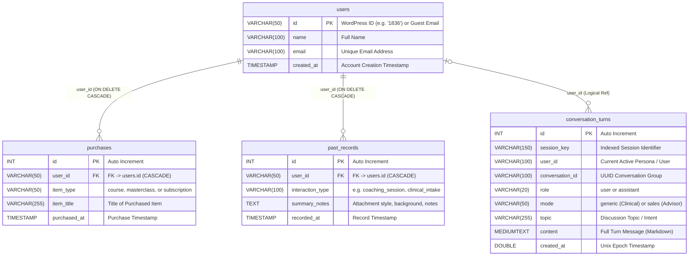

# 🗄️ Database Schema & Relational Architecture (`rag_users`)

> **AWS EC2 MySQL 8.4** • Database: `rag_users`  
> Connected in **Antigravity IDE** via **SQLTools** (`AWS EC2 MySQL (rag_users)` on local port `3306`)

---

## 🗺️ Visual Entity-Relationship Diagram (ERD)

---

## 🔍 How to View in Antigravity IDE

### Method 1: Using SQLTools Tree View
1. Click the **SQLTools icon** (cylinder with plug) in the Antigravity left Activity Bar.
2. Under **CONNECTIONS**, locate **`AWS EC2 MySQL (rag_users)`**.
3. Click the **Connect** (plug) icon.
4. Expand **`rag_users`** ➔ **`Tables`**.
5. Every table will automatically show:
   - 📁 **Columns** (with column type & PK key badge)
   - 📁 **Indexes** (Primary Key, unique keys, and composite indexes)
   - 📁 **Foreign Keys** (`fk_purchases_user` ➔ `users.id`, `fk_records_user` ➔ `users.id`)
6. Right-click any table ➔ **"Describe Table"** (or press `Ctrl+E Ctrl+D`) to open a dedicated visual schema inspector tab.
7. Right-click any table ➔ **"Show Table Records"** to inspect live tabular rows.

---

### Method 2: Running the Pre-Written Schema Inspector
Open [`scripts/inspect_schema.sql`](file:///c:/DSH%20RAG/RAG-DSH/scripts/inspect_schema.sql) in Antigravity IDE, select the connection **`AWS EC2 MySQL (rag_users)`**, and click **"Run on active connection"** (or press `Ctrl+E Ctrl+E`). It will output:
- Complete column definitions (data types, nullability, defaults)
- All foreign key relationships with parent/child mappings
- All indexes and uniqueness constraints
- Live record counts across all 4 tables

---

### Method 3: Live Studio Web Viewer
You can also view this interactive schema anytime with real-time statistics in the browser at:  
👉 **[https://agent.doctorsarahhensley.com](https://agent.doctorsarahhensley.com)** ➔ Click **`🗄️ Database Tables`** ➔ **`🗺️ Schema (ERD)`**.
